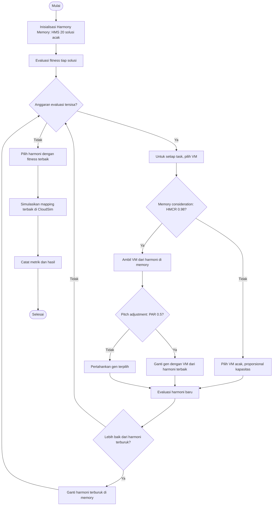
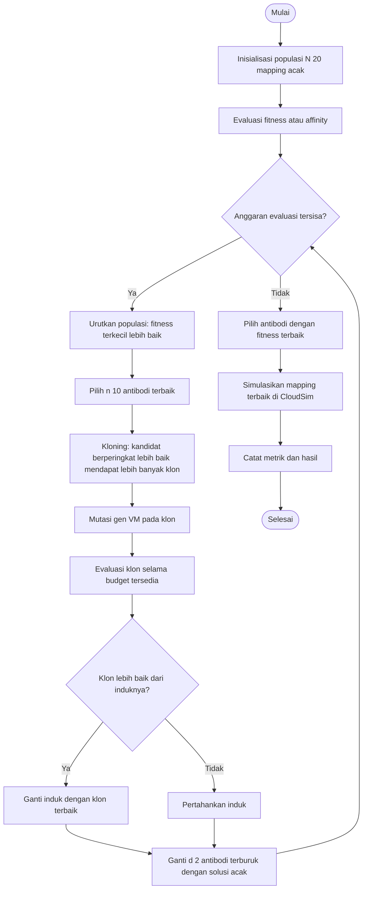

# Simulasi Penjadwalan CloudSim dengan Harmony Search dan CSA

Proyek ini membandingkan dua algoritma metaheuristik untuk memetakan task ke
virtual machine (VM), kemudian menjalankan pemetaan tersebut pada simulasi
cloud menggunakan **CloudSim Plus 6.6.1**.

> **Catatan tentang situs demo:** [PPT ALGORITMA HS DAN CSA](https://meyrosa.github.io/algortimameta_kel5/)
> adalah demo edukasi interaktif untuk menjelaskan HS dan CSA. Demo itu tidak
> menjalankan CloudSim Plus, tidak membaca dataset GoCJ di repository ini, dan
> tidak terhubung dengan program Java. Untuk simulasi CloudSim, jalankan
> perintah di README ini dari repository.

## Isi proyek

- `src/main/java/project/`: eksperimen CloudSim, pembaca dataset, fungsi
  objektif, algoritma HS/CSA, infrastruktur, dan pengumpulan metrik.
- `src/main/resources/dataset/GoCJ_Dataset_100.txt`: dataset 100 task.
- `src/main/resources/dataset/GoCJ_Dataset_500.txt`: dataset 500 task.
- `src/main/resources/dataset/GoCJ_Dataset_1000.txt`: dataset 1.000 task.
- `src/main/resources/dataset/dataset.txt`: contoh kecil 5 task.
- `run.sh`: runner uji cepat atau rangkaian eksperimen CloudSim dan analisis.
- `scripts/analyze.py`: membuat ringkasan, uji Wilcoxon berpasangan, dan kurva
  konvergensi dari hasil simulasi.
- `realworld/`: runner opsional yang mengirim beban kerja ke container Docker.
  Bagian ini bukan simulasi CloudSim dan tidak diperlukan untuk menjalankan
  eksperimen di README ini.

## Persyaratan

- Java 11 atau lebih baru.
- Maven 3.x.
- Python 3 (hanya diperlukan untuk analisis hasil oleh `run.sh`).

Maven mengunduh dependensi CloudSim Plus dan Jackson saat build pertama.
Docker tidak diperlukan untuk eksperimen CloudSim.

## Menjalankan simulasi

Dari direktori utama repository:

```bash
mvn -q compile
```

### Uji cepat tanpa dataset GoCJ

Perintah ini membangun program dan menjalankan HS serta CSA pada contoh
internal 5 task, dua run per algoritma. Ini adalah cara tercepat untuk
memastikan simulator bisa dijalankan:

```bash
./run.sh --quick
```

Jika izin eksekusi skrip belum tersedia, jalankan `bash run.sh --quick`.

### Satu eksperimen pada dataset yang tersedia

Contoh berikut menjalankan HS pada dataset 100 task, satu run, seed 42,
bobot `w=0.5`, dan anggaran 1.000 evaluasi fitness:

```bash
mvn -q exec:java \
  -Dexec.args="src/main/resources/dataset/GoCJ_Dataset_100.txt HS 1 42 0.5 1000"
```

Untuk menjalankan CSA pada dataset yang sama:

```bash
mvn -q exec:java \
  -Dexec.args="src/main/resources/dataset/GoCJ_Dataset_100.txt CSA 1 42 0.5 1000"
```

Argumen program berurutan:

```text
Experiment [file_dataset|-] [HS|CSA] [jumlah_run=10] [seed=42] [w=0.5] [budget=10000]
```

- Gunakan path file dataset untuk membaca panjang task dalam satuan MI.
  Pembaca menerima angka yang dipisahkan spasi, koma, atau titik koma; teks
  setelah `#` dianggap komentar.
- Gunakan `-` untuk contoh internal 5 task.
- Setiap run memakai seed `seed + nomor_run - 1`, sehingga percobaan dapat
  diulang dengan seed yang sama.
- `w` harus berada pada rentang 0 sampai 1. Nilai lebih besar memberi bobot
  lebih besar pada makespan; nilai lebih kecil memberi bobot lebih besar pada
  energi. Nilai bawaan `0.5` menyeimbangkan keduanya.
- `budget` adalah jumlah maksimum evaluasi fungsi fitness. Untuk parameter
  bawaan, nilainya minimal 20.
- Jumlah run lebih dari satu menampilkan rata-rata dan simpangan baku metrik.

### Rangkaian eksperimen lengkap

```bash
./run.sh
```

Secara bawaan skrip menjalankan dataset 100, 500, dan 1.000 task untuk HS dan
CSA, dengan `w=0.5`, `0.8`, dan `0.2`, masing-masing 10 run dan anggaran
10.000 evaluasi. Skrip juga memeriksa determinisme, membandingkan mapping
implementasi Java dan Python, lalu membuat analisis. Rangkaian ini lebih lama
daripada uji cepat.

Opsi runner yang tersedia:

```bash
./run.sh --help
./run.sh --algorithm HS --runs 3 --seed 42 --budget 1000 --no-sensitivity --no-verify
```

`--algorithm` menerima `HS` atau `CSA`. `--no-sensitivity` hanya menjalankan
`w=0.5`; `--no-verify` melewati pengecekan mapping Python. Runner lengkap
memindahkan isi `results/simulation/` yang lama ke direktori backup bertanggal
sebelum membuat hasil baru, bukan menghapusnya.

## Bagaimana eksperimen bekerja

Setiap kandidat solusi adalah array mapping `mapping[i] = j`: task ke-i
ditempatkan pada VM ke-j. Fitness yang diminimalkan adalah:

```text
F(x) = w * (Cmax(x) / C_LB) + (1 - w) * (E(x) / E_LB)
```

`Cmax` adalah makespan analitik kandidat, `E` adalah estimasi energi, dan
`C_LB` serta `E_LB` adalah batas bawah untuk instance tersebut. Algoritma
mencari mapping dengan anggaran evaluasi yang sama. Mapping terbaik lalu
dijalankan pada CloudSim untuk mengukur hasil simulasi. Karena itu, fitness
adalah fungsi objektif pencarian, sedangkan metrik CloudSim digunakan untuk
melaporkan perilaku jadwal yang dijalankan.

Infrastruktur simulasi terdiri dari dua datacenter, masing-masing dengan tiga
host, serta 20 VM: 4 VM besar (V3), 8 VM sedang (V2), dan 8 VM kecil (V1).
Penempatan cloudlet ke VM hasil algoritma diperiksa kembali setelah simulasi;
program juga memeriksa bahwa semua VM berhasil dibuat dan semua cloudlet
selesai.

### Flowchart Harmony Search (HS)



**Intinya:** HS menyimpan sekumpulan mapping (Harmony Memory), lalu
membangun mapping baru dengan mengambil keputusan task dari memory atau
secara acak. Pada implementasi diskrit ini, pitch adjustment mengambil VM
untuk gen tersebut dari harmoni terbaik. Kandidat baru menggantikan anggota
memory terburuk hanya jika fitness-nya lebih baik.

### Flowchart Clonal Selection Algorithm (CSA)



**Intinya:** CSA mengurutkan populasi berdasarkan fitness, mengkloning
antibodi terbaik, memutasi gen penempatan task pada klon, lalu mempertahankan
hasil yang lebih baik. Dua kandidat terburuk diganti dengan solusi acak untuk
menambah keragaman. Implementasi menggunakan aturan jumlah mutasi linear
berdasarkan peringkat; batas mutasi adalah `max(1, jumlah_task / 20)`.

Parameter bawaan CSA: populasi `N=20`, antibodi terpilih `n=10`, faktor klon
`beta=1.0`, dan kandidat yang diganti `d=2`.

## Hasil

`Experiment` menampilkan hasil tiap run dan rata-rata ± simpangan baku.
Metrik yang dihitung mencakup fitness, makespan, energi, rata-rata response
time, utilisasi, degree of imbalance, throughput, biaya, dan waktu pencarian.

Untuk eksperimen yang memakai file dataset, hasil ditulis ke
`results/simulation/`:

- `summary.csv`: metrik untuk setiap run.
- `aggregate.csv`: rata-rata dan simpangan baku tiap kelompok run.
- `cloudlets_*.csv`: VM dan waktu mulai/selesai setiap task.
- `convergence_*.csv`: perubahan fitness terbaik selama pencarian.
- `placement.csv`: penempatan VM pada host/datacenter.
- `log_*.txt`: log keluaran runner lengkap.

Setelah analisis, `results/analysis/` berisi tabel ringkasan, hasil uji
Wilcoxon, dan grafik SVG konvergensi. Skrip analisis dapat dijalankan sendiri
dengan:

```bash
python3 scripts/analyze.py
```

## Batasan interpretasi

Ini adalah simulasi berbasis CloudSim Plus yang berjalan lokal, bukan
deployment ke penyedia cloud. Energi dan biaya merupakan model sesuai
konfigurasi proyek. Perbandingan HS dan CSA sebaiknya menggunakan dataset,
seed, bobot `w`, dan anggaran evaluasi yang sama; hasil satu seed saja belum
cukup untuk menyimpulkan algoritma mana yang selalu lebih baik.
