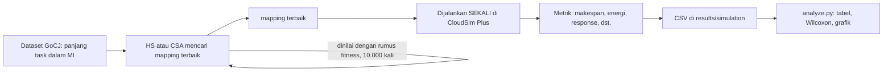
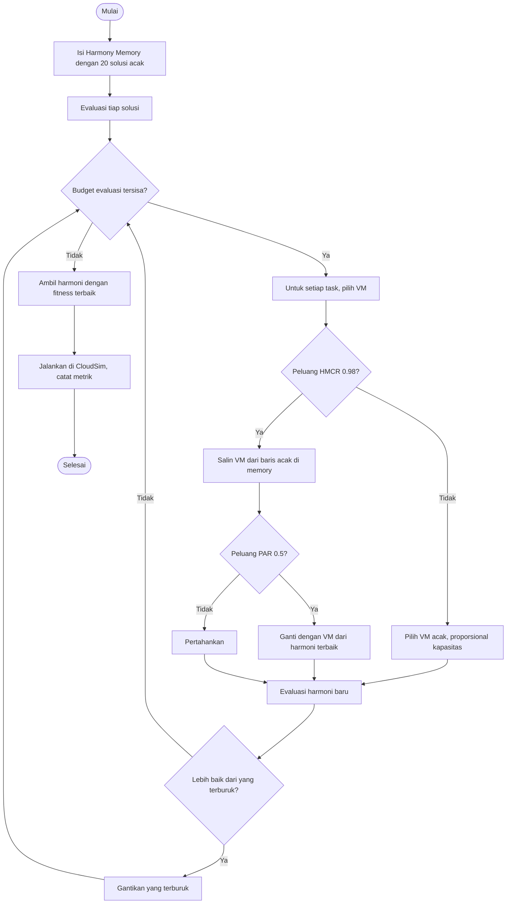
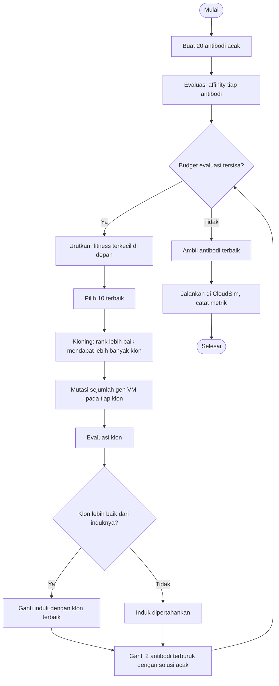
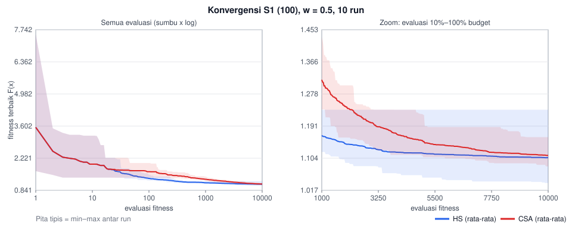
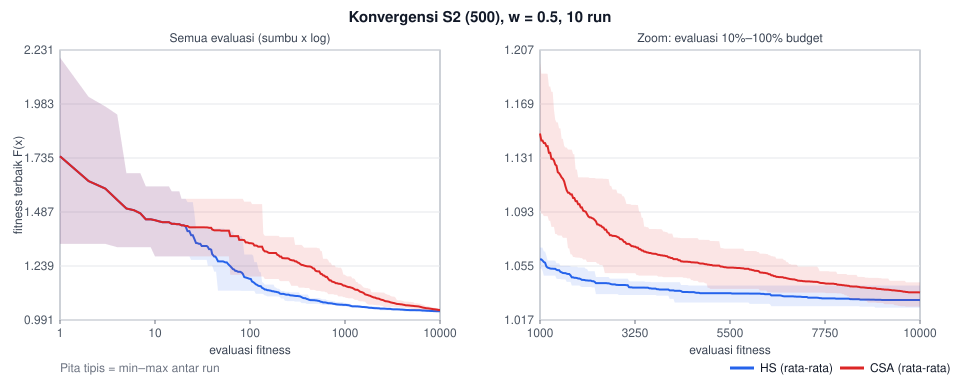
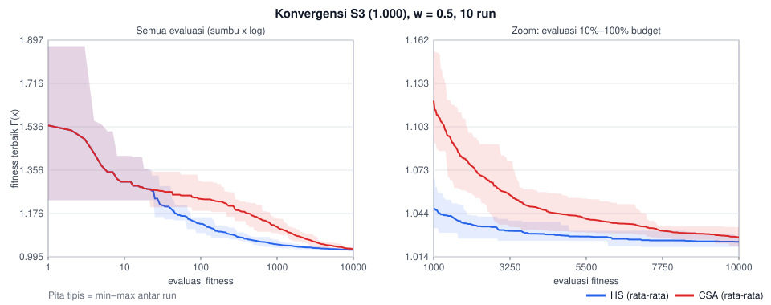

# Penjadwalan Task Cloud dengan Harmony Search dan Clonal Selection Algorithm di CloudSim Plus

Proyek ini membandingkan dua algoritma metaheuristik, **Harmony Search (HS)** dan
**Clonal Selection Algorithm (CSA)**, untuk membagi task ke virtual machine (VM) di
cloud. Tujuannya meminimalkan **makespan** (waktu selesai semua task) dan **energi**.
Pembagian terbaik yang ditemukan kemudian dijalankan di simulator **CloudSim Plus 6.6.1**
untuk diukur secara lengkap.

> **Catatan situs demo:** [PPT ALGORITMA HS DAN CSA](https://meyrosa.github.io/algortimameta_kel5/)
> adalah demo edukasi interaktif. Demo itu tidak menjalankan CloudSim Plus, tidak membaca
> dataset GoCJ di repository ini, dan tidak terhubung dengan program Java. Simulasi CloudSim
> dijalankan lewat perintah di README ini.

## Daftar isi

1. [Masalahnya, dalam analogi warung](#1-masalahnya-dalam-analogi-warung)
2. [Dari warung ke proyek kami](#2-dari-warung-ke-proyek-kami)
3. [Lingkungan simulasi](#3-lingkungan-simulasi)
4. [Fungsi objektif: cara menilai satu pembagian](#4-fungsi-objektif-cara-menilai-satu-pembagian)
5. [Dua algoritma pencari](#5-dua-algoritma-pencari)
6. [Dari mapping ke CloudSim](#6-dari-mapping-ke-cloudsim)
7. [Struktur proyek dan cara menjalankan](#7-struktur-proyek-dan-cara-menjalankan)
8. [Bukti run](#8-bukti-run)
9. [Hasil simulasi](#9-hasil-simulasi)
10. [Pembahasan](#10-pembahasan)
11. [Batasan](#11-batasan)

## Ringkasan hasil

Dataset GoCJ 100 / 500 / 1.000 task, 10 run per konfigurasi (seed 42–51), budget 10.000
evaluasi, bobot `w = 0,5`.

- HS mendapat makespan rata-rata sedikit lebih rendah (0,9% di S2, 0,5% di S3). Perbedaan itu
  bermakna secara statistik di S2 dan S3, tetapi tidak di S1.
- Perbedaan **fitness** HS vs CSA tidak bermakna di ketiga skenario pada `w = 0,5`.
- HS konvergen lebih cepat, tetapi waktu penjadwalannya sekitar 8–15 kali lebih lama.
- Energi hampir seluruhnya ditentukan makespan, sehingga mengubah bobot `w` hampir tidak mengubah hasil.
- Model rumus yang dipakai saat pencarian cocok dengan CloudSim (selisih sekitar 1–1,6%).

---

## 1. Masalahnya, dalam analogi warung

Bayangkan warung dengan **2 kasir**:

- Kasir **Cepat (C)**: kecepatan 2
- Kasir **Lambat (L)**: kecepatan 1

Ada **4 pesanan** berukuran **8, 6, 4, 2**. Pesanan harus dibagi ke kasir supaya **semuanya
selesai secepat mungkin**. Yang menentukan adalah kasir yang paling lama selesai.

Satu cara membagi ditulis sebagai daftar. `[C, C, L, L]` artinya pesanan 8 dan 6 ke Cepat,
pesanan 4 dan 2 ke Lambat. Waktu kasir = jumlah pesanannya ÷ kecepatan.

| Pembagian | Waktu kasir Cepat | Waktu kasir Lambat | Selesai semua |
|:---|:---:|:---:|:---:|
| `[L, L, L, L]` (semua ke Lambat) | 0 | 20 | **20** |
| `[C, L, C, L]` | (8+4)÷2 = 6 | 6+2 = 8 | **8** |
| `[C, C, C, L]` | (8+6+4)÷2 = 9 | 2 | **9** |
| `[C, C, L, L]` | (8+6)÷2 = 7 | 4+2 = 6 | **7** (terbaik) |

**Batas bawah:** total pekerjaan 20 ÷ total kecepatan 3 = **6,67**. Tidak ada pembagian yang
bisa lebih cepat dari itu. Pembagian `[C, C, L, L]` selesai di 7, jadi rasionya 7 ÷ 6,67 ≈ **1,05**
(1,00 adalah sempurna).

**Listrik warung:** lampu menyala selama warung buka (itu biaya tetap, makin lama makin besar),
ditambah sedikit listrik untuk setiap pekerjaan. Jadi selesai lebih cepat berarti hemat energi juga.

**Kenapa tidak dicoba semua saja?** Dengan 4 pesanan ada 2⁴ = 16 kemungkinan. Di proyek kami ada
100 sampai 1.000 task dan 20 kasir, jadi kemungkinannya 20¹⁰⁰ ≈ 10¹³⁰ untuk 100 task. Mustahil
dicoba semua. Karena itu dipakai **metaheuristik**: cara pintar menebak pembagian yang bagus.

> **Intinya:** masalahnya adalah membagi pekerjaan ke pekerja dengan kecepatan berbeda supaya yang
> paling lama selesai sesingkat mungkin.

## 2. Dari warung ke proyek kami

| Di warung | Di proyek | Di kode |
|:---|:---|:---|
| Kasir | VM (20 buah) | `VmFactory` |
| Kecepatan kasir | Kapasitas VM = jumlah PE × MIPS | `vmCapacity[j]` |
| Pesanan | Task (100 / 500 / 1.000) | `taskLength[i]` (dalam MI) |
| Daftar pembagian `[C, C, L, L]` | `mapping` | `int[] mapping`, `mapping[i] = j` |
| Waktu selesai semua | Makespan | `Cmax` di `ObjectiveFunction` |
| Batas bawah 6,67 | `C_LB` | `makespanLowerBound` |
| Kalkulator menilai pembagian | Fungsi fitness | `ObjectiveFunction.evaluate` |
| Buku catatan pembagian | Harmony Memory (HS) | `memory[][]` |
| Fotokopi lalu diubah sedikit | Kloning dan mutasi (CSA) | `clone`, `mutationCount` |

Alur besarnya ada tiga lapis:



**Kenapa rumus dulu, CloudSim belakangan?** Menilai satu pembagian pakai rumus itu seperti memakai
kalkulator. Menjalankannya di CloudSim seperti benar-benar membuka warung. Untuk mencoba 10.000
pembagian, kalkulator jauh lebih masuk akal. CloudSim dipakai sekali di akhir untuk memastikan
rumusnya tidak menyimpang dan untuk mengukur metrik yang lengkap.

> **Intinya:** algoritma menebak, rumus menilai, dan CloudSim memverifikasi pemenangnya.

## 3. Lingkungan simulasi

### Infrastruktur

| | DC-1 Performance | DC-2 Efficiency |
|:---|:---|:---|
| Host | 3 host Tipe A: 8 PE × 3.000 MIPS, RAM 32 GB | 3 host Tipe B: 8 PE × 1.800 MIPS, RAM 32 GB |
| Daya host | idle 175 W, maks 250 W | idle 72 W, maks 120 W |
| Biaya | $0,05/s, $0,02/GB RAM | $0,03/s, $0,01/GB RAM |
| VM yang terisi | 4 V3 + 4 V2 (24/24 PE) | 4 V2 + 8 V1 (16/24 PE) |

| Tipe VM | Jumlah | PE × MIPS | RAM | Indeks VM |
|:---|:---:|:---:|:---:|:---:|
| V3 Large | 4 | 4 × 2.500 | 8 GB | 0–3 |
| V2 Medium | 8 | 2 × 1.500 | 4 GB | 4–11 |
| V1 Small | 8 | 1 × 1.000 | 2 GB | 12–19 |

Kapasitas tiap VM (PE × MIPS): V3 = 10.000, V2 = 3.000, V1 = 1.000, total **72.000 MIPS**.

### Aturan penempatan VM ke host (tetap, tidak dipengaruhi algoritma)

Aturan ini ada di `setup/ConstrainedPlacement.java`. VM ditempatkan dengan urutan: **coba DC-1 dulu**,
lalu DC-2, dan di dalam datacenter pilih **host dengan PE terpakai paling sedikit**. Host harus
lolos empat syarat:

```java
// ConstrainedPlacement.fits (baris 33)
return usedPes(host) + vm.getNumberOfPes() <= host.getNumberOfPes()   // C3: PE cukup
        && vm.getMips() <= host.getMips()                             // C6: MIPS/PE VM <= MIPS/PE host
        && host.isSuitableForVm(vm);                                  // C4, C5: RAM dan bandwidth
```

Syarat **C6** yang membuat V3 (2.500 MIPS/PE) tidak bisa masuk host DC-2 (1.800 MIPS/PE), sehingga
keempat V3 selalu di DC-1. Hasil penempatan nyata (`results/simulation/placement.csv`):

| Datacenter | Host | VM yang ditempatkan | PE terpakai |
|:---|:---:|:---|:---:|
| DC-1 | 0 | vm0 (V3), vm3 (V3) | 8/8 |
| DC-1 | 1 | vm1 (V3), vm4 (V2), vm6 (V2) | 8/8 |
| DC-1 | 2 | vm2 (V3), vm5 (V2), vm7 (V2) | 8/8 |
| DC-2 | 0 | vm8, vm11 (V2), vm16, vm19 (V1) | 6/8 |
| DC-2 | 1 | vm9 (V2), vm12, vm14, vm17 (V1) | 5/8 |
| DC-2 | 2 | vm10 (V2), vm13, vm15, vm18 (V1) | 5/8 |

CloudSim Plus 6.6.1 mencoba ulang VM yang gagal di DC-1 ke DC-2, tetapi tidak mengirim cloudlet
VM tersebut. Karena itu `planDatacenters` (baris 53) menentukan datacenter tiap VM dari awal,
dengan aturan yang sama.

### Dataset GoCJ

| Skenario | File | Jumlah task | Panjang task (MI): min / rata-rata / maks | Total (MI) | C_LB (s) |
|:---:|:---|---:|:---:|---:|---:|
| S1 | `GoCJ_Dataset_100.txt` | 100 | 15.000 / 135.095 / 900.000 | 13.509.500 | 187,63 |
| S2 | `GoCJ_Dataset_500.txt` | 500 | 15.000 / 130.003 / 900.000 | 65.001.500 | 902,80 |
| S3 | `GoCJ_Dataset_1000.txt` | 1.000 | 15.000 / 129.662 / 900.000 | 129.662.000 | 1.800,86 |

> **Intinya:** infrastrukturnya tetap: 2 datacenter, 6 host, 20 VM. Yang dicari algoritma hanya
> task mana ke VM mana.

## 4. Fungsi objektif: cara menilai satu pembagian

Satu solusi adalah array `mapping`, dengan `mapping[i] = j` artinya task ke-i dijalankan di VM ke-j.
Rumus yang diminimalkan:

```text
beban VM j  = jumlah ( panjang task i / kapasitas VM j )       untuk semua task i di VM j
Cmax        = beban VM terbesar                                (makespan)
E           = Cmax × 741 W  +  jumlah ( κ × panjang task i )   (energi)
C_LB        = jumlah semua panjang task / jumlah kapasitas semua VM
E_LB        = C_LB × 741  +  κ_min × jumlah semua panjang task
F           = w × (Cmax / C_LB)  +  (1 − w) × (E / E_LB)       ← diminimalkan
```

| Simbol | Arti | Nilai di proyek |
|:---|:---|:---|
| 741 W | Daya idle semua host | 3 × 175 W + 3 × 72 W |
| κ | Energi dinamis per MI = (Pmaks − Pidle) / (PE × MIPS host) | 0,003125 J/MI (DC-1), 0,003333 J/MI (DC-2) |
| w | Bobot makespan | 0,5 (uji sensitivitas: 0,8 dan 0,2) |

**Kenapa dibagi batas bawah?** Makespan (detik) dan energi (joule) tidak bisa langsung dijumlah.
Setelah dibagi batas bawahnya keduanya menjadi angka tanpa satuan yang nilainya ≥ 1, sehingga
**F = 1 adalah optimum teoretis**. Batas bawahnya hanya bergantung pada dataset, jadi skala F
tidak berubah selama pencarian.

Padanannya di warung: makespan = waktu kasir terlama (7), batas bawah = 6,67, rasio = 1,05.

### Kodenya (`model/ObjectiveFunction.java`)

```java
// vmLoads: beban tiap VM
loads[vm] += taskLength[task] / vmCapacity[vm];

// makespan (baris 63): beban VM terbesar
double max = loads[0];
for (int vm = 1; vm < loads.length; vm++) if (loads[vm] > max) max = loads[vm];

// energy (baris 90): bagian idle + bagian dinamis
dynamic += energyModel.joulePerMi(mapping[task]) * taskLength[task];
return makespan * energyModel.idleWatts() + dynamic;

// evaluate (baris 55): satu panggilan = satu evaluasi dari budget
evaluations++;
return weight * (makespan / makespanLowerBound) + (1.0 - weight) * (energy / energyLowerBound);
```

Satu evaluasi hanya satu lintasan atas semua task, jadi murah dan bisa dipanggil 10.000 kali per run.

> **Intinya:** fitness adalah "nilai rapor" sebuah pembagian. Makin mendekati 1, makin mendekati sempurna.

## 5. Dua algoritma pencari

Kedua algoritma memakai fungsi objektif yang sama, budget **10.000 evaluasi** yang sama, dan seed
yang sama. Karena populasi awal dibuat dengan cara dan urutan yang sama, **HS dan CSA mulai dari
20 solusi awal yang identik**.

Solusi acak dibuat dengan `randomVm()`, yang memilih VM **proporsional kapasitas** (bukan seragam):

```java
// MetaheuristicScheduler.randomVm (baris 91)
double r = random.nextDouble();
for (int vm = 0; vm < cumulativeShare.length; vm++)
    if (r < cumulativeShare[vm]) return vm;
```

Peluang tiap VM: V3 = 10.000/72.000 = 13,9%, V2 = 4,2%, V1 = 1,4%. Artinya VM yang besar lebih
sering dipilih, sehingga solusi awal tidak terlalu buruk.

### 5.1 Harmony Search (HS)

**Analogi warung: "contek buku catatan".** Kamu menyimpan buku berisi 20 pembagian. Untuk membuat
pembagian baru, setiap pesanan kamu putuskan dengan menyontek catatan yang ada. Hampir selalu kamu
mencontek, kadang kamu contek catatan terbaik, dan sesekali (2%) kamu asal pilih kasir. Kalau hasilnya
lebih bagus dari catatan paling jelek, catatan jelek itu dibuang dan diganti.

Contoh dengan 3 catatan (aslinya 20):

| Catatan | Pembagian | Waktu |
|:---|:---|:---:|
| 1 | `[L, L, L, L]` | 20 (terjelek) |
| 2 | `[C, L, C, L]` | 8 |
| 3 | `[C, C, L, L]` | 7 (terbaik) |

Membuat pembagian baru, pesanan demi pesanan:

- P1: catatan acak (kebetulan no. 2) → **C**
- P2: catatan acak (no. 1) → L, tetapi 50% peluang diganti isi catatan terbaik (no. 3) → **C**
- P3: catatan acak (no. 2) → **C**
- P4: catatan acak (no. 3) → **L**

Hasilnya `[C, C, C, L]` dengan waktu 9. Karena 9 lebih bagus dari catatan terjelek (20), catatan 1
digantikan. Lalu diulang.

**Parameter:** `HMS = 20` (jumlah catatan), `HMCR = 0,98` (peluang mencontek catatan), `PAR = 0,5`
(peluang gen yang dicontek diganti milik harmoni terbaik). Sisa 2% memilih VM acak.

**Varian yang dipakai:** Global-best HS. Pada HS klasik, pitch adjustment "menggeser nada sedikit".
Di sini nilai gen adalah indeks VM, yang tidak punya makna jarak (VM 5 tidak "dekat" dengan VM 6),
sehingga gen yang disesuaikan diambil dari harmoni terbaik.

#### Kodenya (`scheduler/HarmonySearchScheduler.java`, method `search`, baris 47)

```java
// Langkah 1: Harmony Memory berisi HMS vektor acak, masing-masing dievaluasi
for (int h = 0; h < hms; h++) {
    memory[h] = randomSolution(taskCount);
    fitness[h] = evaluate(memory[h]);
}

for (int iteration = hms; iteration < maxEvaluations(); iteration++) {
    int best = argMin(fitness);
    int[] harmony = new int[taskCount];

    // Langkah 2: improvisasi, satu keputusan per task
    for (int task = 0; task < taskCount; task++) {
        int vm;
        if (random().nextDouble() < hmcr) {                  // 98%: memory consideration
            vm = memory[random().nextInt(hms)][task];        //   salin dari baris acak
            if (random().nextDouble() < par) {               //   50%: pitch adjustment
                vm = memory[best][task];                     //   ganti dengan milik harmoni terbaik
            }
        } else {
            vm = randomVm();                                 // 2%: random consideration
        }
        harmony[task] = vm;
    }

    // Langkah 3: harmoni baru menggantikan yang terburuk bila lebih baik
    double newFitness = evaluate(harmony);
    int worst = argMax(fitness);
    if (newFitness < fitness[worst]) {
        memory[worst] = harmony;
        fitness[worst] = newFitness;
    }
}
return memory[argMin(fitness)];                              // jawaban: harmoni terbaik
```

Satu iterasi membangun satu harmoni dan memakai satu evaluasi, jadi 20 awal + 9.980 iterasi = tepat 10.000.



**Sifat HS:** pembagian baru adalah campuran seluruh catatan yang condong ke yang terbaik, sehingga
**cepat membaik**. Kelemahannya, lama-lama semua catatan menjadi mirip dan satu-satunya sumber ide baru
tinggal 2% pilihan acak (sekitar 2 gen per harmoni pada 100 task).

> **Intinya:** HS membuat solusi baru dengan mencampur yang sudah ada. Cepat, tetapi bisa kehabisan variasi.

### 5.2 Clonal Selection Algorithm (CSA)

**Analogi warung: "fotokopi lalu utak-atik sedikit".** Ambil pembagian yang bagus, fotokopi, lalu
ubah sedikit (pindahkan satu atau beberapa pesanan ke kasir lain). Kalau ada fotokopi yang lebih bagus
dari aslinya, aslinya diganti. Kalau tidak, aslinya tetap dipakai.

Contoh 1 (tidak ada yang membaik). Aslinya `[C, C, L, L]` (waktu 7):

- pindahkan P3 ke C → `[C, C, C, L]` = 9 (lebih jelek)
- pindahkan P2 ke L → `[C, L, L, L]` = 12 (lebih jelek)
- pindahkan P4 ke C → `[C, C, L, C]` = 8 (lebih jelek)

Tidak ada yang lebih bagus dari 7, jadi aslinya tetap.

Contoh 2 (ada yang membaik). Aslinya `[C, L, C, L]` (waktu 8). Pindahkan P4 ke C → `[C, L, C, C]`:
Cepat = (8+4+2)÷2 = 7, Lambat = 6, jadi waktunya 7. Lebih bagus dari 8, jadi **aslinya diganti**.

**Aturan CSA di kode:**

- Populasi 20 antibodi. Setiap generasi, urutkan dari yang terbaik, lalu ambil **10 terbaik**.
- **Jumlah klon** per rank: `floor(20 / (rank+1))`, yaitu 20, 10, 6, 5, 4, 3, 2, 2, 2, 2 (total 56 klon).
- **Jumlah gen yang dimutasi** naik menurut rank. Di S1 (maksimum 5 gen): 1, 1, 1, 2, 2, 3, 3, 4, 4, 5.
  Di S3 (maksimum 50 gen) dari 1 sampai 50. Rank terbaik hanya diubah sedikit, yang kurang baik diubah banyak.
- Klon terbaik menggantikan induknya **hanya jika lebih baik** (induk bagus tidak pernah hilang).
- **Receptor editing:** 2 antibodi terburuk diganti solusi acak baru supaya ada variasi segar.
- Satu generasi memakai sekitar 58 evaluasi, jadi budget 10.000 habis di sekitar 172 generasi.

**Parameter:** `N = 20`, `n = 10`, `β = 1,0`, `d = 2`, mutasi maksimum `max(1, jumlah task / 20)`.

#### Kodenya (`scheduler/ClonalSelectionScheduler.java`, method `search`, baris 71)

```java
// Fungsi pembantu (baris 56-66)
maxMutation(taskCount)   = Math.max(1, taskCount / 20);                      // S1=5, S2=25, S3=50
cloneCount(rank)         = Math.max(1, (int) (cloneFactor * populationSize / (rank + 1)));
mutationCount(rank, max) = 1 + rank * (max - 1) / Math.max(1, selected - 1);  // naik linear menurut rank

// Inisialisasi: 20 antibodi acak dievaluasi
// Loop utama, selama budget masih ada:
sortByAffinity(population, affinity);                        // Langkah 1: urutkan, terbaik di depan

for (int rank = 0; rank < selected && budgetLeft(); rank++) {
    int clones = cloneCount(rank);                           // Langkah 2: jumlah klon
    int mutations = mutationCount(rank, maxMutation);        //            jumlah gen yang diubah
    int[] bestClone = null;
    double bestAffinity = affinity[rank];                    // klon harus mengalahkan induknya
    for (int c = 0; c < clones && budgetLeft(); c++) {
        int[] clone = population[rank].clone();              // fotokopi
        for (int k = 0; k < mutations; k++) {                // Langkah 3: hipermutasi
            int gene = random().nextInt(taskCount);          //   pilih task acak
            clone[gene] = randomVm();                        //   beri VM acak
        }
        double cloneAffinity = evaluate(clone);
        if (cloneAffinity < bestAffinity) {                  // Langkah 4: simpan klon terbaik
            bestAffinity = cloneAffinity;
            bestClone = clone;
        }
    }
    if (bestClone != null) {                                 // ganti induk hanya bila ada yang lebih baik
        population[rank] = bestClone;
        affinity[rank] = bestAffinity;
    }
}

for (int k = populationSize - replaced; k < populationSize && budgetLeft(); k++) {
    population[k] = randomSolution(taskCount);               // Langkah 5: receptor editing
    affinity[k] = evaluate(population[k]);
}
```

Rumus `exp(−ρ·f)` dari CLONALG asli sengaja diganti aturan linear menurut rank. Dengan begitu pencarian
hanya memakai `nextInt` dan `nextDouble`, tanpa fungsi matematika yang bisa berbeda antar platform, sehingga
hasil Java bisa diulang persis di Python (lihat bagian Bukti run).



**Sifat CSA:** solusi bagus tidak pernah hilang dan perbaikannya sedikit demi sedikit, sehingga lebih
**stabil**, tetapi lebih pelan membaik di awal.

> **Intinya:** CSA memperbaiki solusi bagus sedikit demi sedikit. Pelan di awal, tetapi stabil.

### 5.3 Perbedaan inti

| | HS | CSA |
|:---|:---|:---|
| Cara membuat solusi baru | Merakit seluruh gen dari memory (rekombinasi) | Mengubah sedikit gen dari satu induk (mutasi) |
| Arah pencarian | Ditarik ke harmoni terbaik | Elit diperbaiki sedikit demi sedikit |
| Sumber variasi | Hanya 2% pilihan acak | Mutasi tiap generasi + 2 antibodi acak baru |
| Yang digantikan | 1 harmoni terburuk | Induk (jika klon lebih baik) + 2 terburuk |
| Kecenderungan | Konvergen cepat, bisa macet | Lebih lambat, lebih stabil |

> **Intinya:** fungsi objektif yang sama, strategi mencari yang berbeda. Karena itu perbandingannya adil.

## 6. Dari mapping ke CloudSim

Setelah HS atau CSA selesai, `mapping[]` terbaik dikirim ke CloudSim (`setup/SimulationSetup.java`).

**1. Satu cloudlet per task**, dengan jumlah PE sama dengan VM tujuannya (baris 48):

```java
int pes = (int) vmList.get(mapping[i]).getNumberOfPes();
long lengthPerPe = Math.round(taskLengths[i] / pes);
Cloudlet cloudlet = new CloudletSimple(i, lengthPerPe, pes) ...
```

Karena cloudlet memakai semua PE VM-nya, waktunya = panjang / (PE × MIPS) = panjang / kapasitas.
Itu persis rumus di fungsi objektif.

**2. Task di VM yang sama antre satu per satu.** Di `VmFactory`, setiap VM memakai
`CloudletSchedulerSpaceShared`. Jadi waktu selesai sebuah VM adalah jumlah waktu seluruh task-nya,
sama dengan "beban VM" di rumus.

**3. Cloudlet dikunci ke VM tujuan** (baris 65):

```java
broker.setDatacenterMapper((lastDc, vm) -> plan.get(vm));   // datacenter hasil planDatacenters
broker.submitVmList(vmList);
broker.submitCloudletList(cloudlets);
for (int i = 0; i < mapping.length; i++)
    if (!broker.bindCloudletToVm(cloudlets.get(i), vmList.get(mapping[i])))
        throw new IllegalStateException("Cloudlet " + i + " could not be bound to VM " + mapping[i]);
simulation.start();
validate();
```

Pengikatan harus setelah cloudlet diserahkan ke broker, karena sebelum itu pengikatan diabaikan diam-diam.
Karena itu hasilnya diperiksa dan program berhenti dengan error bila gagal.

**4. Validasi setiap run** (`validate()`, baris 87): 20 dari 20 VM berhasil dibuat, semua cloudlet
selesai, dan setiap cloudlet berjalan di VM yang dijadwalkan. Kegagalan pembuatan VM di CloudSim tidak
berisik, jadi dicek eksplisit.

**5. `broker.setVmDestructionDelay(Double.MAX_VALUE)`:** VM idle tetap hidup sampai batch selesai, sehingga
biayanya tetap dihitung.

### Definisi metrik (`metrics/MetricsCollector.java`)

| Metrik | Cara menghitung |
|:---|:---|
| Makespan | Waktu selesai cloudlet terakhir di seluruh VM |
| Energi | Dihitung `EnergyMeter` dari model daya host selama 0 sampai makespan |
| Avg response time | Rata-rata waktu selesai semua task (semua task masuk di t = 0) |
| Utilisasi (%) | 100 × jumlah waktu selesai tiap VM / (20 × makespan) |
| DI (degree of imbalance) | (Tmaks − Tmin) / Trata-rata waktu selesai VM. `DI semua VM` memasukkan VM yang tidak dapat task. `DI VM terpakai` hanya VM yang kebagian task. Makin kecil makin merata |
| Throughput | Jumlah task / makespan |
| Biaya | Biaya proses + memori + bandwidth tiap VM (storage tidak dihitung) |
| Waktu penjadwalan | Lama `schedule()` saja, dengan pemanasan JIT sebelum run pertama |

> **Intinya:** yang dikirim ke CloudSim hanya `mapping`. Fitness dihitung dengan rumus, sedangkan
> semua metrik laporan diukur dari simulasi.

## 7. Struktur proyek dan cara menjalankan

```text
src/main/java/project/
  Experiment.java                   program utama (alur run, CSV)
  data/GoCJLoader.java              membaca dataset
  model/ObjectiveFunction.java      rumus fitness
  model/EnergyModel.java            κ dan daya idle
  scheduler/MetaheuristicScheduler  bagian bersama HS dan CSA (seed, budget, trace)
  scheduler/HarmonySearchScheduler  inti HS
  scheduler/ClonalSelectionScheduler  inti CSA
  setup/VmFactory                   definisi 20 VM
  setup/DatacenterFactory           2 datacenter dan 6 host
  setup/ConstrainedPlacement        aturan penempatan VM ke host
  setup/SimulationSetup             menjalankan mapping di CloudSim
  metrics/MetricsCollector          penghitungan metrik
src/main/resources/dataset/         GoCJ_Dataset_100/500/1000.txt dan dataset.txt (5 task)
scripts/analyze.py                  tabel, uji Wilcoxon, grafik konvergensi
scripts/population_sweep.sh         uji ukuran populasi HS/CSA (lihat 9.6)
scripts/population_analysis.py      tabel dan grafik uji ukuran populasi
realworld/                          runner opsional (Docker) dan verify_mapping.py
results/simulation | determinism | analysis | population
run.sh                              runner uji cepat atau eksperimen lengkap
```

**Persyaratan:** Java 11+, Maven 3.x, dan Python 3 (untuk analisis dan verifikasi). Docker tidak diperlukan.

```bash
mvn -q compile
./run.sh --quick          # uji cepat: HS dan CSA pada contoh 5 task
```

Satu eksperimen pada satu dataset:

```bash
mvn -q exec:java -Dexec.args="src/main/resources/dataset/GoCJ_Dataset_100.txt HS 1 42 0.5 1000"
# urutan argumen: [dataset|-] [HS|CSA] [jumlah_run=10] [seed=42] [w=0.5] [budget=10000]
```

Ukuran populasi bawaan adalah 20 (HMS untuk HS, N untuk CSA). Untuk mengubahnya, tambahkan
`-Dpop=N` sebelum `exec:java`:

```bash
mvn -q -Dpop=10 exec:java -Dexec.args="src/main/resources/dataset/GoCJ_Dataset_1000.txt CSA 10 42 0.5 10000"
```

Eksperimen lengkap dan analisis:

```bash
./run.sh                          # 3 dataset × HS/CSA × w 0.5/0.8/0.2 × 10 run
python3 scripts/analyze.py        # hasilnya di results/analysis/
```

Setiap run memakai `SimulationSetup` baru dan seed `seed + nomor_run − 1`. Hasil lama dipindah ke
backup bertanggal, tidak dihapus.

## 8. Bukti run

### 8.1 Keluaran program (`results/simulation/log_GoCJ_Dataset_100_HS_w0.5.txt`)

```text
scheduler=HS(HMS=20, HMCR=0.98, PAR=0.5) dataset=GoCJ_Dataset_100 tasks=100 runs=10 seed=42..51 w=0.5 budget=10000
Total: 2 datacenter, 6 host, 20 VM | sum P_idle = 741 W, kappa DC-1 = 0.003125 J/MI, kappa DC-2 = 0.003333 J/MI

[run 1/10 seed=42] fitness=1.039516 evaluations=10000 | tasks=100, vmsCreated=20/20, cloudletsFinished=100/100
  makespan=199.073 s (analitik 195.600 s), energy=0.0530 kWh (analitik 0.0522 kWh), avgResponse=106.634 s
  utilization=88.96%, DI=0.6429 (VM terpakai 0.6429), throughput=0.5023 task/s, cost=$304.30, schedulingTime=89.628 ms
[run 2/10 seed=43] fitness=1.235579 evaluations=10000 | tasks=100, vmsCreated=20/20, cloudletsFinished=100/100
  makespan=240.596 s (analitik 237.500 s), energy=0.0614 kWh (analitik 0.0607 kWh), avgResponse=117.785 s
  utilization=52.02%, DI=1.9225 (VM terpakai 1.2754), throughput=0.4156 task/s, cost=$354.13, schedulingTime=80.054 ms
```

Yang bisa ditunjukkan dari log ini:

- `evaluations=10000`: budget terpakai tepat.
- `vmsCreated=20/20` dan `cloudletsFinished=100/100`: validasi CloudSim lolos.
- `makespan` (CloudSim) dibanding `analitik`: selisihnya kecil.
- **Run 2 (seed 43)** hasilnya jauh lebih buruk (fitness 1,2356, utilisasi 52%). Ini contoh run HS yang terjebak, dan dibahas di bagian Pembahasan.

### 8.2 Task benar-benar antre di VM yang sama (`cloudlets_GoCJ_Dataset_100_HS_w0.5_run1.csv`)

```text
task_id,length_mi,vm,vm_type,datacenter,host,start_s,finish_s
1,83000,0,V3,1,0,0.1000,8.4300
2,63000,0,V3,1,0,8.5400,14.8500
```

Task 1 dan 2 sama-sama di VM 0 (V3, kapasitas 10.000 MIPS). Task 1 butuh 83.000 / 10.000 = 8,3 detik
dan selesai di 8,43. Task 2 baru mulai di 8,54 dan butuh 6,3 detik. Ini bukti bahwa task di VM yang
sama berjalan **satu per satu**, sesuai rumus beban VM.

### 8.3 Hasil determinisme (`results/determinism/`)

Menjalankan ulang run 1 pada S1 dengan seed yang sama menghasilkan mapping yang **sama persis** untuk
HS maupun CSA. Itu membuktikan hasilnya bisa diulang.

### 8.4 Verifikasi silang Java dan Python (`results/simulation/verify_mapping.txt`)

`realworld/verify_mapping.py` menjalankan ulang HS dan CSA di Python (meniru `java.util.Random`) dan
membandingkannya dengan hasil Java:

```text
GoCJ_Dataset_100 HS  run 1 seed=42: IDENTIK - 100 / 100 task sama, fitness sama (1.039516165183047) [Python 1.8 s]
GoCJ_Dataset_100 CSA run 1 seed=42: IDENTIK - 100 / 100 task sama, fitness sama (1.1613942707443736) [Python 0.2 s]
GoCJ_Dataset_500 HS  run 1 seed=42: IDENTIK - 500 / 500 task sama, fitness sama (1.028182221117401) [Python 9.4 s]
```

Semua pengecekan yang tercatat menunjukkan mapping dan fitness identik sampai semua digit. Dua
implementasi independen yang menghasilkan jawaban sama adalah bukti kuat bahwa kode HS dan CSA
berjalan sesuai rancangan.

### 8.5 Jejak konvergensi (`convergence_GoCJ_Dataset_100_HS_w0.5_run1.csv`)

```text
evaluation,best_fitness
1,1.6655453408792846
33,1.6483546545000882
44,1.599534512060641
...
9881,1.039516165183047
10000,1.039516165183047
```

File ini mencatat fitness terbaik pada setiap perbaikan. Dari 1,67 pada evaluasi pertama turun ke
1,0395 pada evaluasi ke-9.881. Dari file seperti ini grafik konvergensi dibuat.

## 9. Hasil simulasi

Nilai adalah rata-rata ± simpangan baku (sampel, n − 1) dari 10 run. Tabel lengkap ada di
`results/analysis/tables.md`.

### 9.1 Metrik CloudSim (w = 0,5)

| Skenario | Algoritma | Fitness | Makespan (s) | Energi (kWh) | Avg response (s) | Utilisasi (%) | DI (VM terpakai) | Throughput (task/s) | Biaya (USD) | Waktu jadwal (ms) |
|:---:|:---:|---:|---:|---:|---:|---:|---:|---:|---:|---:|
| S1 (100) | HS | 1,1055 ± 0,0737 | 212,57 ± 15,93 | 0,0557 ± 0,0032 | 111,60 ± 7,09 | 75,20 ± 13,42 | 0,866 ± 0,213 | 0,4727 ± 0,0331 | 320,49 ± 19,11 | 84,2 ± 4,3 |
| S1 (100) | CSA | 1,1116 ± 0,0263 | 213,45 ± 5,65 | 0,0559 ± 0,0011 | 111,90 ± 2,55 | 72,39 ± 4,82 | 0,968 ± 0,136 | 0,4688 ± 0,0122 | 321,55 ± 6,78 | 10,5 ± 2,5 |
| S2 (500) | HS | 1,0312 ± 0,0045 | 944,13 ± 4,86 | 0,2520 ± 0,0010 | 473,59 ± 3,00 | 92,21 ± 1,63 | 0,406 ± 0,112 | 0,5296 ± 0,0027 | 1.198,37 ± 5,84 | 430,4 ± 16,0 |
| S2 (500) | CSA | 1,0365 ± 0,0054 | 952,72 ± 6,06 | 0,2537 ± 0,0012 | 473,34 ± 5,10 | 88,88 ± 1,27 | 0,662 ± 0,108 | 0,5248 ± 0,0033 | 1.208,68 ± 7,27 | 30,8 ± 2,3 |
| S3 (1.000) | HS | 1,0244 ± 0,0024 | 1.872,74 ± 6,18 | 0,5006 ± 0,0013 | 905,80 ± 4,56 | 93,78 ± 1,17 | 0,287 ± 0,131 | 0,5340 ± 0,0018 | 2.312,71 ± 7,42 | 956,7 ± 13,4 |
| S3 (1.000) | CSA | 1,0275 ± 0,0043 | 1.882,53 ± 8,51 | 0,5025 ± 0,0017 | 906,59 ± 4,09 | 91,10 ± 1,39 | 0,556 ± 0,154 | 0,5312 ± 0,0024 | 2.324,45 ± 10,22 | 65,2 ± 8,7 |

Semakin kecil semakin baik untuk fitness, makespan, energi, response, DI, biaya, dan waktu
penjadwalan. Semakin besar semakin baik untuk utilisasi dan throughput. Waktu penjadwalan bergantung
pada mesin yang dipakai menjalankan.

### 9.2 Rumus vs CloudSim (w = 0,5)

| Skenario | Algoritma | Makespan rumus (s) | Makespan CloudSim (s) | Selisih | Energi rumus (kWh) | Energi CloudSim (kWh) | Selisih |
|:---:|:---:|---:|---:|---:|---:|---:|---:|
| S1 | HS | 209,70 | 212,57 | 1,37% | 0,0550 | 0,0557 | 1,16% |
| S1 | CSA | 211,01 | 213,45 | 1,16% | 0,0553 | 0,0559 | 1,00% |
| S2 | HS | 932,55 | 944,13 | 1,24% | 0,2494 | 0,2520 | 1,06% |
| S2 | CSA | 938,08 | 952,72 | 1,56% | 0,2505 | 0,2537 | 1,31% |
| S3 | HS | 1.846,37 | 1.872,74 | 1,43% | 0,4946 | 0,5006 | 1,21% |
| S3 | CSA | 1.852,87 | 1.882,53 | 1,60% | 0,4959 | 0,5025 | 1,34% |

Makespan hasil HS berada sekitar 11,8% (S1), 3,3% (S2), dan 2,5% (S3) di atas batas bawah `C_LB`.
Untuk CSA sekitar 12,5%, 3,9%, dan 2,9%. Makin banyak task, makin dekat jadwal ke batas bawah.

### 9.3 Uji Wilcoxon signed-rank berpasangan

Pasangan = seed yang sama, dua sisi, eksak, α = 0,05. Tabel memuat p-value makespan CloudSim. Nilai
untuk energi identik karena energi hampir seluruhnya ditentukan makespan.

| Skenario | w = 0,5 | w = 0,8 | w = 0,2 |
|:---:|:---:|:---:|:---:|
| S1 (100) | 0,4316 | 0,4316 | 0,8457 |
| S2 (500) | **0,0488** (HS lebih baik) | **0,0059** (HS lebih baik) | 0,5566 |
| S3 (1.000) | **0,0098** (HS lebih baik) | 0,4922 | **0,0371** (HS lebih baik) |

Untuk fitness pada `w = 0,5`, p-value-nya 0,4316 (S1), 0,0840 (S2), dan 0,4922 (S3), jadi tidak ada
yang bermakna. Satu-satunya perbedaan fitness yang bermakna ada pada `w = 0,8` di S2 (p = 0,0195, HS
lebih baik). Daftar lengkap ada di `results/analysis/wilcoxon.csv`. Jumlah run di mana HS lebih baik
dari CSA pada makespan rumus (seed yang sama): 7 dari 10 (S1), 9 dari 10 (S2), 5 dari 10 (S3).

### 9.4 Sensitivitas bobot w

Makespan CloudSim (detik), rata-rata 10 run:

| Skenario | Algoritma | w = 0,8 | w = 0,5 | w = 0,2 |
|:---:|:---:|---:|---:|---:|
| S1 | HS | 212,48 | 212,57 | 213,78 |
| S1 | CSA | 214,16 | 213,45 | 214,38 |
| S2 | HS | 942,27 | 944,13 | 951,25 |
| S2 | CSA | 951,41 | 952,72 | 953,07 |
| S3 | HS | 1.876,71 | 1.872,74 | 1.873,72 |
| S3 | CSA | 1.878,55 | 1.882,53 | 1.885,94 |

Mengubah `w` hampir tidak mengubah hasil. Penyebabnya, energi idle (`741 W × Cmax`) sekitar 77% dari
total energi, dan komponen dinamisnya hampir konstan (0,0119 kWh di S1, 0,0574 kWh di S2, 0,1145 kWh
di S3) karena κ kedua datacenter hampir sama. Meminimalkan makespan sudah hampir sama dengan meminimalkan
energi. Fitness antar `w` tidak dibandingkan karena fungsinya berbeda.

### 9.5 Konvergensi

Rata-rata fitness terbaik (10 run, `w = 0,5`) pada evaluasi ke-N. Pada evaluasi ke-20 nilainya sama
karena populasi awal HS dan CSA identik.

| Skenario | Algoritma | 20 | 100 | 1.000 | 5.000 | 10.000 |
|:---:|:---:|---:|---:|---:|---:|---:|
| S1 | HS | 1,7498 | 1,3524 | 1,1655 | 1,1177 | 1,1055 |
| S1 | CSA | 1,7498 | 1,6418 | 1,3169 | 1,1520 | 1,1116 |
| S2 | HS | 1,4256 | 1,1802 | 1,0599 | 1,0360 | 1,0312 |
| S2 | CSA | 1,4256 | 1,3437 | 1,1486 | 1,0561 | 1,0365 |
| S3 | HS | 1,2772 | 1,1327 | 1,0472 | 1,0281 | 1,0244 |
| S3 | CSA | 1,2772 | 1,2368 | 1,1209 | 1,0426 | 1,0275 |





Kurva untuk `w = 0,8` dan `w = 0,2` ada di `results/analysis/`.

## 10. Pembahasan

- **Kualitas solusi.** HS mendapat makespan dan energi rata-rata sedikit lebih rendah (0,5–0,9%).
  Perbedaannya bermakna di S2 dan S3 untuk makespan pada `w = 0,5`, tetapi tidak di S1 dan tidak
  untuk fitness. Jadi tidak bisa dikatakan HS selalu lebih baik.
- **Kecepatan konvergensi.** HS turun lebih cepat di awal. Interpretasi: HS menyusun seluruh gen
  sekaligus dari memory dan menarik gen ke harmoni terbaik, sedangkan CSA hanya mengubah sedikit gen
  per klon. Di akhir budget selisih keduanya mengecil.
- **Stabilitas.** Di S1 HS kurang stabil (simpangan baku fitness 0,0737 vs 0,0263). Dua run (seed 43
  dan 50) berhenti di makespan sekitar 237,5 s (lihat run 2 di Bukti run). Dugaan: `HMCR = 0,98`
  membuat isi memory cepat seragam sehingga pencarian macet. Dugaan ini belum diuji dengan variasi parameter.
- **Biaya komputasi.** HS 8–15 kali lebih lambat (84 vs 10,5 ms di S1, 957 vs 65 ms di S3).
  Kemungkinan besar karena HS menarik beberapa angka acak per task di setiap iterasi.
- **Energi vs makespan.** Pada konfigurasi ini keduanya hampir sejalan (lihat sensitivitas `w`).
- **Rumus vs CloudSim.** Selisih makespan sekitar 1–1,6%. Dari berkas cloudlet terlihat task pertama
  di sebuah VM baru mulai di 0,1 s, dan setiap task berikutnya mulai sekitar 0,11 s setelah task
  sebelumnya selesai. Overhead per task ini kemungkinan ikut menyumbang selisih, karena makin banyak
  task di VM terberat makin besar selisihnya. Penyebab pastinya belum diuji lebih jauh.

## 11. Batasan

- Ini simulasi lokal berbasis CloudSim Plus, bukan deployment ke penyedia cloud. Energi dan biaya
  adalah model sesuai konfigurasi proyek.
- Setiap konfigurasi hanya 10 run. Ada 27 uji Wilcoxon tanpa koreksi pengujian berganda, sehingga hasil
  dengan p mendekati 0,05 (misalnya S2, `w = 0,5`: p = 0,0488) sebaiknya dibaca hati-hati.
- Hasil berlaku untuk parameter bawaan (HMS 20, HMCR 0,98, PAR 0,5; N 20, n 10, β 1,0, d 2), tiga
  dataset GoCJ, dan satu konfigurasi infrastruktur. Parameter belum di-tuning.
- Folder `realworld/` bersifat opsional dan tidak ada hasilnya di repository ini.

## Keluaran

- `results/simulation/`: `summary.csv` (metrik tiap run), `aggregate.csv` (rata-rata dan std),
  `cloudlets_*.csv` (VM, mulai, dan selesai tiap task), `convergence_*.csv`, `placement.csv`,
  `log_*.txt`, `verify_mapping.txt`.
- `results/determinism/`: bukti pengulangan dengan seed yang sama.
- `results/analysis/`: `tables.md`, `wilcoxon.csv`, dan grafik `convergence_*.svg`
  (dibuat dengan `python3 scripts/analyze.py`).
